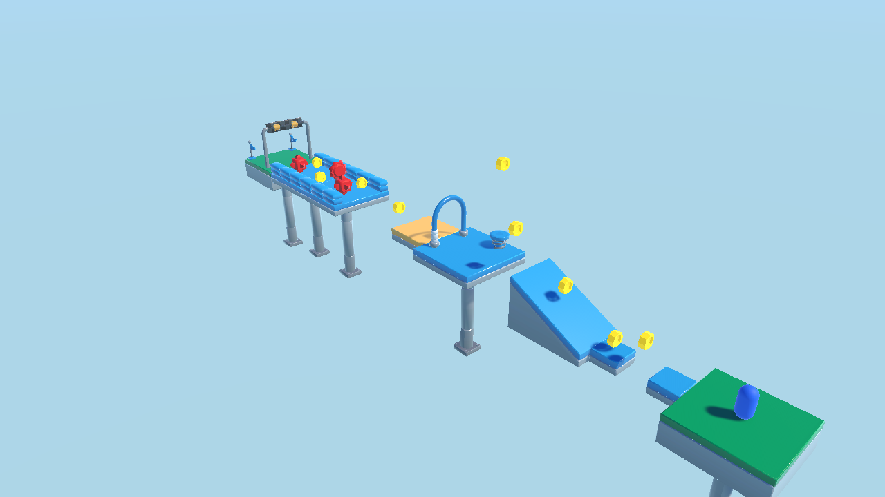

# Unity Basics Workshop: Build an Obstacle Course

A hands-on Unity 6 workshop by VGDA @ CSULB. You build a 3D platformer obstacle course in about an hour.

- **Attendees, start here:** [Docs/README.md](Docs/README.md) (install, open, night-before checklist)
- **Jump to a step:** [Docs/CHECKPOINTS.md](Docs/CHECKPOINTS.md)
- Instructors: [Docs/MANUAL_SETUP.md](Docs/MANUAL_SETUP.md) (in the git repository only; the attendee zips leave it out)

Unity **6000.3.8f1** (6.3 LTS) · Universal 3D (URP) · Input System · Cinemachine 3

